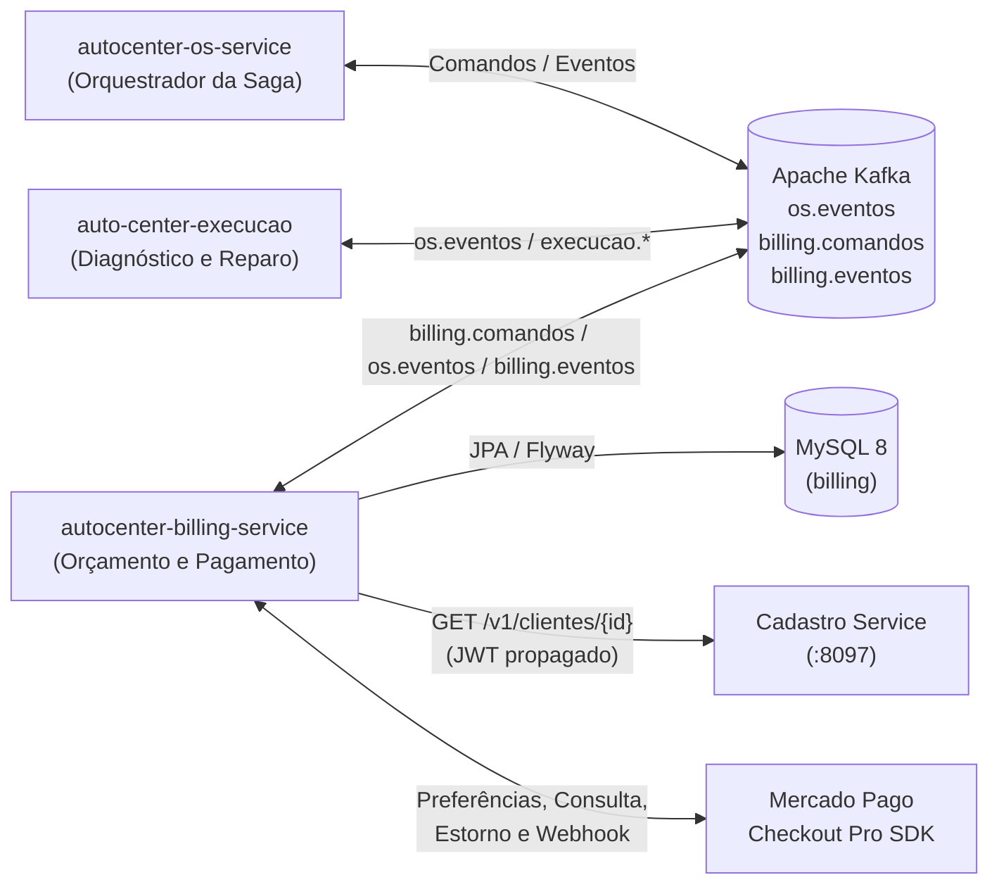
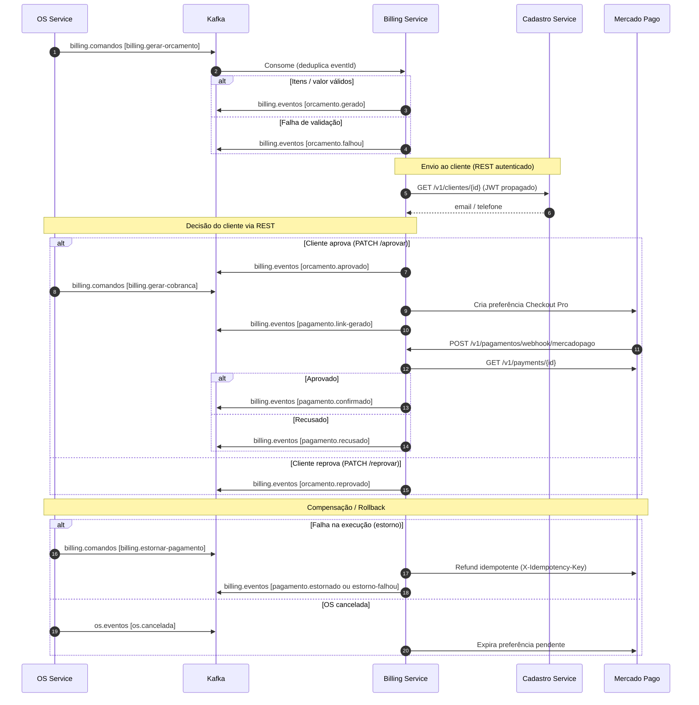
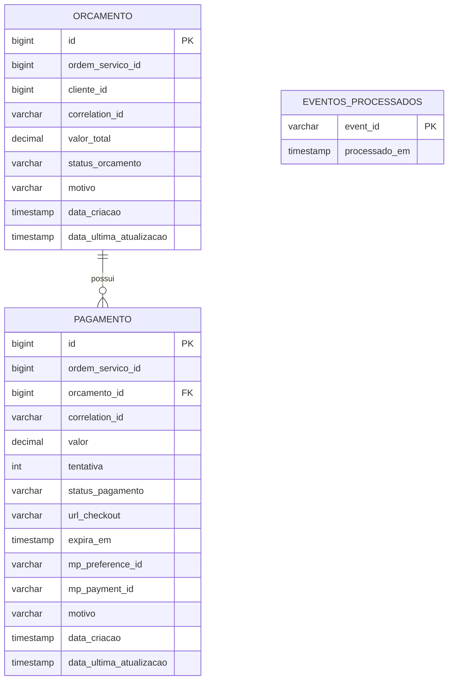
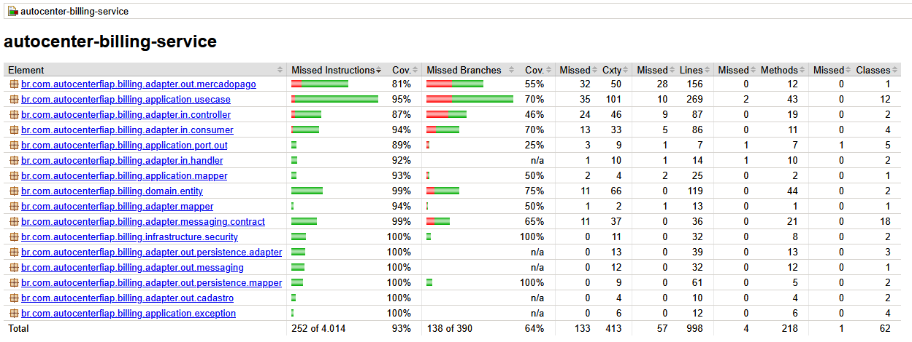

<h1 align="center">Auto Center FIAP — Microsserviço de Orçamento e Pagamento (Billing)</h1>

<p align="center">
  
  
  
  
  
  
</p>

Microsserviço responsável pelo ciclo completo de **orçamentos**, **cobranças** e **pagamentos** (com integração oficial **Mercado Pago Checkout Pro**) no ecossistema distribuído do **Tech Challenge — Fase 4**.

---

## Sumário

1. [Arquitetura do Serviço](#1-arquitetura-do-serviço)
2. [Fluxo da Saga e Compensação](#2-fluxo-da-saga-e-compensação)
3. [Modelo de Dados (MySQL + Flyway)](#3-modelo-de-dados-mysql--flyway)
4. [Contrato Kafka](#4-contrato-kafka)
5. [Endpoints REST, Segurança JWT e Swagger / Postman](#5-endpoints-rest-segurança-jwt-e-swagger--postman)
6. [Observabilidade](#6-observabilidade)
7. [Como Executar Localmente](#7-como-executar-localmente)
8. [Testes, BDD e Evidências de Cobertura](#8-testes-bdd-e-evidências-de-cobertura)
9. [Docker, Kubernetes e CI/CD](#9-docker-kubernetes-e-cicd)

---

## 1. Arquitetura do Serviço

### 1.1 Contexto no Ecossistema de Microsserviços



### 1.2 Clean Architecture (Ports & Adapters)

O código segue **Clean Architecture**, isolando regras de negócio puras de frameworks, banco de dados, mensageria e SDK externo:

```text
src/main/java/br/com/autocenterfiap/billing/
├── domain/
│   ├── entity/          # Entidades puras (Orcamento, Pagamento) e invariantes de estado
│   └── enums/           # StatusOrcamento, StatusPagamento, TipoEnvio
├── application/
│   ├── usecase/         # Casos de uso (GerarOrcamento, Aprovar, Reprovar, Enviar, GerarCobranca, ProcessarPagamento, Estornar, Cancelar)
│   ├── port/out/        # Contratos de saída (OrcamentoRepositoryPort, PagamentoRepositoryPort, MercadoPagoPort, ClientePort, BillingEventPublisherPort, EventoProcessadoPort)
│   ├── dto/ & mapper/   # DTOs e mappers desacoplados de HTTP e JPA
│   └── exception/       # Exceções de negócio
├── adapter/
│   ├── in/
│   │   ├── consumer/    # BillingComandosConsumer, OsEventosConsumer
│   │   ├── controller/  # OrcamentoController, PagamentoController
│   │   ├── dto/ & mapper/ & handler/
│   ├── messaging/contract/  # EventoEnvelope, TipoEvento, BillingPayloads, ItensContrato
│   └── out/
│       ├── cadastro/    # ClienteRestAdapter (consulta contato no Cadastro Service)
│       ├── mercadopago/ # MercadoPagoSdkAdapter (SDK 2.1.21 + modo stub)
│       ├── messaging/   # BillingKafkaPublisher
│       └── persistence/ # JPA entities, repositories, mappers e adapters
└── infrastructure/
    ├── config/          # Beans de UseCase, KafkaErrorConfig, CadastroClientConfig, RepassaTokenInterceptor
    └── security/        # ConfiguracaoSeguranca, FiltroJwt (HS256)
```

| Camada | Responsabilidade | Exemplos no código |
|---|---|---|
| `domain` | Regras de transição e invariantes sem dependência de Spring/JPA | `Orcamento.aprovar()`, `Pagamento.confirmar()`, `StatusOrcamento.ehTerminal()` |
| `application` | Orquestração dos fluxos e definição das portas de saída | `GerarCobrancaUseCase`, `EstornarPagamentoUseCase`, `EnviarOrcamentoUseCase` |
| `adapter.in` | Entrada REST (Swagger/JWT) e consumers Kafka | `OrcamentoController`, `PagamentoController`, `BillingComandosConsumer` |
| `adapter.out` | Integração com MySQL, Kafka, Mercado Pago SDK e Cadastro REST | `PagamentoRepositoryJpaAdapter`, `MercadoPagoSdkAdapter`, `ClienteRestAdapter` |
| `infrastructure` | Segurança JWT, tratamento de erros/DLT Kafka e wiring de Beans | `ConfiguracaoSeguranca`, `FiltroJwt`, `KafkaErrorConfig`, `UseCaseConfig` |

---

## 2. Fluxo da Saga e Compensação

### Escolha do Padrão: Saga Orquestrada

O ecossistema adota **Saga Orquestrada**, com o `autocenter-os-service` atuando como orquestrador central e o `autocenter-billing-service` como participante autônomo:

- **Por que Orquestração (e não Coreografia)?**
  - O fluxo envolve múltiplas etapas síncronas e assíncronas, retentativas de cobrança (até 3 tentativas), expiração de link e compensação em cadeia (estorno + cancelamento).
  - Centralizar a máquina de estados no `os-service` elimina acoplamento ponto-a-ponto entre `billing` e `execucao` (os dois não se comunicam diretamente).
- **Resiliência, Idempotência e Compensação:**
  - **Deduplicação por `eventId`**: a tabela `eventos_processados` garante processamento único mesmo em reentrega do Kafka.
  - **Retry + DLT** ([`KafkaErrorConfig`](src/main/java/br/com/autocenterfiap/billing/infrastructure/config/KafkaErrorConfig.java)): erro técnico executa 3 retentativas bloqueantes (`1 s`, `2 s`, `4 s`), preservando a ordem das mensagens por `osId`, e depois encaminha para `<tópico>.dlt` (mesma partição: `billing.comandos.dlt` e `os.eventos.dlt`). JSON inválido vai direto para a DLT.
  - **Invalidação de links anteriores**: ao gerar nova cobrança (`GerarCobrancaUseCase`), cobranças pendentes anteriores da mesma OS são canceladas e suas preferências no Mercado Pago são expiradas.
  - **Estorno real e tardio**: `billing.estornar-pagamento` aciona `PaymentRefundClient` com `X-Idempotency-Key` (suportando reprocessamento a partir de `ESTORNO_FALHOU`), e `ProcessarPagamentoUseCase` realiza estorno automático caso um webhook chegue após o pagamento já estar `CANCELADO`.



---

## 3. Modelo de Dados (MySQL + Flyway)

Banco **MySQL 8** exclusivo do Billing (`V1__criar_tabelas_billing.sql`), sem acesso direto a bancos de outros serviços:



---

## 4. Contrato Kafka

Todas as mensagens usam `osId` como chave de partição e o envelope padrão (`EventoEnvelope<T>`):
`eventId`, `tipo`, `versao`, `osId`, `correlationId`, `ocorridoEm` (ISO-8601), `payload`.

### Eventos Consumidos

| Tópico | `tipo` | Ação no Billing |
|---|---|---|
| `billing.comandos` | `billing.gerar-orcamento` | Cria orçamento (`AGUARDANDO_APROVACAO`) e publica `orcamento.gerado` ou `orcamento.falhou` |
| `billing.comandos` | `billing.gerar-cobranca` | Invalida cobranças anteriores, cria pagamento (`PENDENTE`), gera preferência Checkout Pro e publica `pagamento.link-gerado` |
| `billing.comandos` | `billing.estornar-pagamento` | Estorna pagamento no Mercado Pago e publica `pagamento.estornado` ou `pagamento.estorno-falhou` |
| `os.eventos` | `os.cancelada` | Cancela orçamento/pagamento ativos da OS e expira preferência pendente no Mercado Pago |

### Eventos Publicados (`billing.eventos`)

| `tipo` | Quando é publicado |
|---|---|
| `orcamento.gerado` | Orçamento criado com sucesso |
| `orcamento.falhou` | Falha de validação ao gerar orçamento |
| `orcamento.aprovado` | Cliente aprova o orçamento |
| `orcamento.reprovado` | Cliente reprova o orçamento |
| `pagamento.link-gerado` | Preferência Checkout Pro gerada (`url`, `expiraEm`) |
| `pagamento.confirmado` | Pagamento aprovado (Webhook Mercado Pago ou endpoint de confirmação) |
| `pagamento.recusado` | Pagamento recusado/cancelado no Mercado Pago |
| `pagamento.estornado` | Estorno concluído com sucesso |
| `pagamento.estorno-falhou` | Falha ao estornar pagamento |

---

## 5. Endpoints REST, Segurança JWT e Swagger / Postman

- **Swagger UI**: `http://localhost:8099/swagger-ui.html` (OpenAPI JSON em `/api-docs`)
- **Collection Postman atualizada**: [`docs/autocenter-billing-service.postman_collection.json`](docs/autocenter-billing-service.postman_collection.json)
- **Autenticação**: todas as rotas `/v1/**` (exceto o webhook do Mercado Pago) exigem `Authorization: Bearer <jwt>` (HS256, issuer `Auto Center Fiap`, claim `exp`, autoridade `ROLE_INTERNO`), usando o mesmo segredo (`SISTEMA_SEGURANCA_CHAVE_SECRETA`) do OS Service e do monolito. Ao chamar `/v1/orcamentos/{id}/enviar-cliente`, o token recebido é repassado ao Cadastro Service (`RepassaTokenInterceptor`).

### Orçamentos (`/v1/orcamentos`)

| Método | Rota | Autenticação | Descrição |
|---|---|---|---|
| `GET` | `/v1/orcamentos?status=...` | JWT (`ROLE_INTERNO`) | Lista paginada de orçamentos por status |
| `GET` | `/v1/orcamentos/{id}` | JWT (`ROLE_INTERNO`) | Busca orçamento por ID |
| `GET` | `/v1/orcamentos/os/{osId}` | JWT (`ROLE_INTERNO`) | Lista orçamentos da OS |
| `POST` | `/v1/orcamentos/{id}/enviar-cliente` | JWT (`ROLE_INTERNO`) | Consulta contato no Cadastro e envia orçamento (`EMAIL`, `WHATSAPP`, `IMPRESSAO`) |
| `PATCH` | `/v1/orcamentos/{id}/aprovar` | JWT (`ROLE_INTERNO`) | Aprova orçamento e publica `orcamento.aprovado` |
| `PATCH` | `/v1/orcamentos/{id}/reprovar` | JWT (`ROLE_INTERNO`) | Reprova orçamento e publica `orcamento.reprovado` |

### Pagamentos (`/v1/pagamentos`)

| Método | Rota | Autenticação | Descrição |
|---|---|---|---|
| `POST` | `/v1/pagamentos` | JWT (`ROLE_INTERNO`) | Gera cobrança manualmente e publica `pagamento.link-gerado` |
| `GET` | `/v1/pagamentos/{id}` | JWT (`ROLE_INTERNO`) | Busca pagamento por ID |
| `GET` | `/v1/pagamentos/os/{osId}` | JWT (`ROLE_INTERNO`) | Busca o pagamento mais recente da OS |
| `POST` | `/v1/pagamentos/webhook/mercadopago` | Público | Webhook oficial do Mercado Pago (`type=payment`, `data.id`) |
| `POST` | `/v1/pagamentos/{id}/confirmar` | JWT (`ROLE_INTERNO`) | Confirma pagamento manualmente (auxiliar de demonstração) |
| `POST` | `/v1/pagamentos/{id}/recusar` | JWT (`ROLE_INTERNO`) | Recusa pagamento manualmente (auxiliar de demonstração) |
| `POST` | `/v1/pagamentos/{id}/estornar` | JWT (`ROLE_INTERNO`) | Solicita ou reprocessa estorno |

---

## 6. Observabilidade

- **Health Probes (Actuator):** `/actuator/health`, `/actuator/health/liveness`, `/actuator/health/readiness` (públicos).
- **Métricas Prometheus:** `/actuator/prometheus` (coletado via annotations OpenMetrics do Datadog no `k8s/app-deployment.yaml`).
- **Logs JSON + Rastreamento:** `logback-spring.xml` com `logstash-logback-encoder` e `correlationId` injetado via MDC nos consumers e requisições.
- **APM Datadog:** `dd-java-agent.jar` embutido no `docker/Dockerfile` (`-javaagent:/app/dd-java-agent.jar`).

---

## 7. Como Executar Localmente

### Pré-requisitos
- Java 21, Maven 3.9+, Docker (e `ngrok` caso queira receber Webhooks reais do Mercado Pago Sandbox)

### Passo 1 — Configurar o `.env`
```bash
cp .env.example .env
```
Defina obrigatoriamente `SISTEMA_SEGURANCA_CHAVE_SECRETA` (mesma chave do OS Service) e escolha o modo do Mercado Pago:
- **Mercado Pago Sandbox real (Checkout Pro + estorno real):**
  ```env
  MERCADOPAGO_MODO=real
  MERCADOPAGO_ACCESS_TOKEN=APP_USR-...   # Access Token de TESTE da conta vendedora
  MERCADOPAGO_PUBLIC_KEY=APP_USR-...     # Public Key de TESTE
  ```
  > Para receber o webhook automaticamente na máquina, abra `make tunnel` (`ngrok http 8099`). O serviço consulta `http://localhost:4040/api/tunnels` ao gerar a cobrança ou usa `MERCADOPAGO_NOTIFICATION_URL` se preenchida.
- **Modo offline (`stub`, sem chamadas externas):**
  ```env
  MERCADOPAGO_MODO=stub
  ```

### Passo 2 — Subir Infraestrutura e Aplicação
```bash
make infra-up   # Sobe MySQL (3307) e Kafka KRaft (9092)
make run        # Sobe o billing-service na porta 8099 (profile dev lendo .env)
```

### Passo 3 — Rodando o Ecossistema Completo
- **`autocenter-os-service`**: `8098`
- **`autocenter-billing-service`**: `8099` (`CADASTRO_URL=http://localhost:8097` por padrão)
- **`auto-center-execucao`**: sobrescreva `SERVER_PORT=8096` (ou `8095`) se subir localmente junto com o OS Service

---

## 8. Testes, BDD e Evidências de Cobertura

- **Testes unitários:** 22 classes de teste cobrindo domínio, casos de uso, controllers, consumers, publisher, adaptadores JPA/REST/Mercado Pago e segurança JWT (`FiltroJwt`, `RepassaTokenInterceptor`).
- **Teste BDD (Cucumber + Testcontainers):** [`billing.feature`](src/test/resources/features/billing.feature) executa o fluxo ponta a ponta contra **MySQL 8** e **Kafka** reais em containers Docker (com Mercado Pago em modo `stub`).
- **Gate de qualidade:** JaCoCo configurado no [`pom.xml`](pom.xml) exigindo **cobertura mínima de 80% de linhas** no `mvn verify`.

```bash
mvn clean verify
```

### Evidências de Cobertura e Qualidade (`mvn clean verify`)
- **Testes executados:** `55` (`0` falhas, `0` erros, `0` ignorados — 54 unitários + suíte BDD Cucumber)
- **Cobertura medida (JaCoCo):**
  - **Linhas (`LINE`):** **94,29%** (`941 / 998`)
  - **Instruções (`INSTRUCTION`):** **93,72%** (`3762 / 4014`)
  - **Métodos (`METHOD`):** **98,17%** (`214 / 218`)
  - **Classes (`CLASS`):** **98,39%** (`61 / 62`)
- **SonarCloud:** [Dashboard do projeto `AutocenterFiap_autocenter-billing-service`](https://sonarcloud.io/project/overview?id=AutocenterFiap_autocenter-billing-service)
- **Relatório local JaCoCo:** gerado em `target/site/jacoco/index.html` após `mvn clean verify` e publicado como artefato `jacoco-report` no GitHub Actions.





---

## 9. Docker, Kubernetes e CI/CD

- **Docker:** [`docker/Dockerfile`](docker/Dockerfile) (multi-stage Maven + JRE 21 + `dd-java-agent.jar`, porta `8099`).
- **Kubernetes:** manifestos em [`k8s/`](k8s/README.md) (Namespace `auto-center-billing`, MySQL StatefulSet, Deployment com `wait-for-mysql`, probes e Datadog, Service NodePort `30099`, HPA e Kustomize). No cluster, aponta para `kafka.autocenter.svc.cluster.local:9092` e `http://cadastro-service.autocenter.svc.cluster.local:8097`.
- **Pipelines:**
  - [`.github/workflows/ci.yml`](.github/workflows/ci.yml): `mvn clean verify` (unitários + BDD Testcontainers + gate JaCoCo ≥ 80%), análise obrigatória no **SonarCloud** (`sonar:sonar` com Quality Gate em PRs e na `main`) e deploy automatizado no cluster via [`scripts/deploy-kind.sh`](scripts/deploy-kind.sh) no runner `self-hosted`.
  - [`.github/workflows/cd.yml`](.github/workflows/cd.yml): build e push da imagem Docker para o GHCR a cada push na `main`.

| Branch | Cluster kind | GitHub Environment |
|---|---|---|
| `main` | `autocenter` (`kind-autocenter`) | `producao` |
| `homologacao` | `autocenter-qa` (`kind-autocenter-qa`) | `homologacao` |
